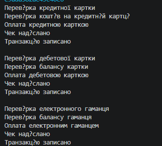

# Лабораторна робота №11: DocumentProcessor: шаблонні кроки й реалізації.

**Студент:** Андрій Щур
**Група:** КН 3/1
**Варіант:** №N 10
---

## Опис проєкту
Консольний проєкт на C#, що демонструє використання абстрактних класів, наслідування, поліморфізму та патерну Template Method на прикладі обробки платежів.

---

## Структура класів

* **PaymentProcessor** — базовий абстрактний клас із шаблонним методом `Process()`.
* **CreditCardPayment** — обробка оплати кредитною карткою.
* **DebitCardPayment** — обробка оплати дебетовою карткою.
* **WalletPayment** — обробка оплати електронним гаманцем.
* **Program** — запуск програми та перевірка роботи класів.

---

## Висновок
Під час лабораторної роботи було реалізовано патерн Template Method, використано абстрактні класи, наслідування та перевизначення методів.

--- 

## Приклад
