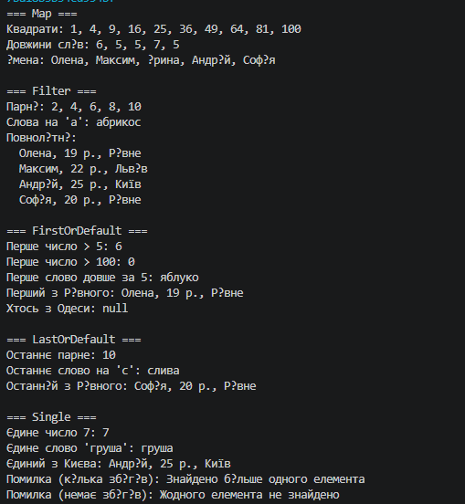

# Лабораторна робота №13 Generic-методи для повторного використання компонентів: Mapper/MaxBy/Reduce з Func/Action.
Варіант 10 Щур Андрій КН 3/1

## Опис проєкту
Консольний проєкт на C#, що демонструє generic-методи для повторного використання логіки, делегати `Func<T, TResult>`, `Predicate<T>`, `Action<T>` та функції вищого порядку над колекціями.

---

## Реалізовані методи (варіант 10)

* **Map** — перетворює кожен елемент колекції за допомогою `Func<T, TResult>`.
* **Filter** — повертає елементи, що задовольняють умову `Func<T, bool>`.
* **FirstOrDefault** — повертає перший елемент за умовою `Predicate<T>` або `default`.
* **LastOrDefault** — повертає останній елемент за умовою `Predicate<T>` або `default`.
* **Single** — повертає єдиний елемент за умовою, інакше кидає `InvalidOperationException`.

Додатково реалізовано допоміжний метод **ForEach** з делегатом `Action<T>`.

---

## Структура класів

* **FunctionalUtils** — статичний клас із generic-методами.
* **Person** — тестовий клас (`Name`, `Age`, `City`).
* **Program** — демонстрація роботи методів з типами `int`, `string` та `Person`.

---

## Запуск

    dotnet run --project lab12v10

---

## Приклад
