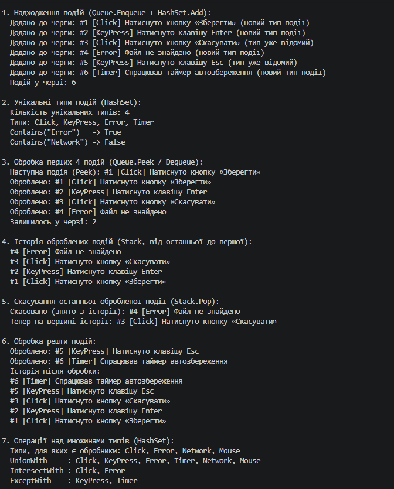

# Лабораторна робота №14 HashSet/Queue/Stack: практичні сценарії. 
Варіант 10 Щур Андрій КН 3/1
## Опис проєкту

Консольний проєкт на C#, що демонструє використання спеціалізованих колекцій `HashSet<T>`, `Queue<T>` та `Stack<T>` на прикладі системи обробки подій: події надходять, ставляться в чергу, обробляються за порядком надходження, а оброблені події зберігаються в історії з можливістю скасування.

---

## Реалізовані підзадачі 

* **HashSet\<string\>** — зберігає унікальні типи подій (Click, KeyPress, Error, Timer); дублікати ігноруються, перевірка наявності — `Contains`. Також демонструє операції над множинами: `UnionWith`, `IntersectWith`, `ExceptWith`.
* **Queue\<AppEvent\>** — черга подій для обробки за принципом FIFO: `Enqueue`, `Dequeue`, `Peek`.
* **Stack\<AppEvent\>** — історія оброблених подій за принципом LIFO: `Push`, `Pop`, `Peek`; дозволяє скасувати останню оброблену подію.

Додатково реалізовано порівняння продуктивності пошуку `List<string>.Contains` і `HashSet<string>.Contains`.

---

## Структура класів

* **AppEvent** — `record` з полями `Id`, `Type`, `Message`.
* **EventProcessor** — клас із трьома колекціями та методами `Publish`, `ProcessNext`, `ProcessAll`, `PeekNext`, `UndoLast`, `PrintHistory`, `HasType`, `TypesUnion`, `TypesIntersect`, `TypesExcept`.
* **Program** — демонстрація роботи кожної колекції з описом кожного кроку та порівнянням продуктивності.
---
## Приклад
