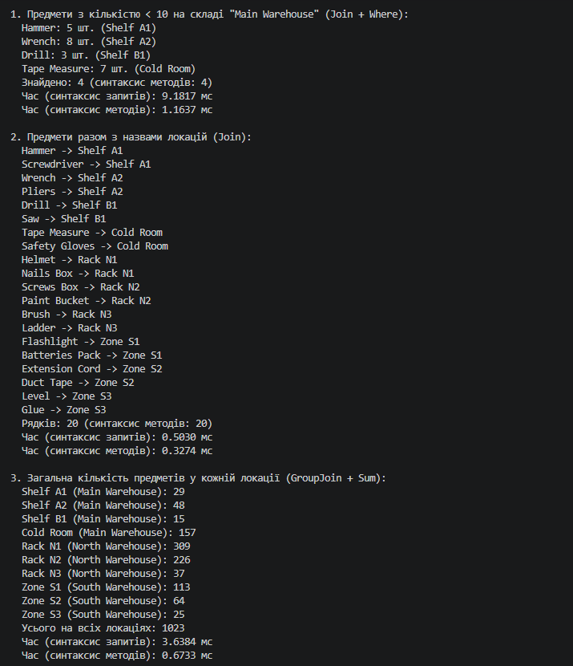
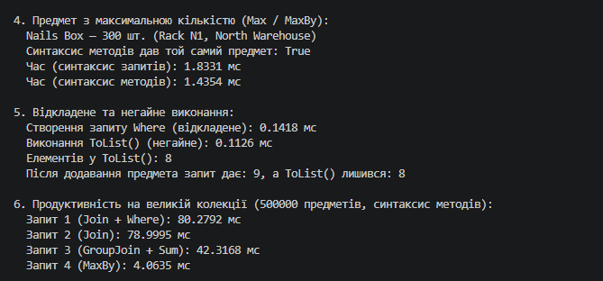

# Лабораторна робота №15 — LINQ: фільтрація, об'єднання та агрегація даних
Варіант 10 Щур Андрій КН 3/1

## Опис проєкту

Консольний проєкт на C#, що демонструє використання LINQ для фільтрації (`Where`), об'єднання (`Join`, `GroupJoin`) та агрегації (`Sum`, `Max`, `MaxBy`) даних на прикладі системи управління інвентарем. Кожен запит реалізовано двома способами — синтаксисом запитів і синтаксисом методів, а час виконання виміряно за допомогою `System.Diagnostics.Stopwatch`.

---

## Реалізовані запити

1. **Предмети з кількістю < 10 на складі "Main Warehouse"** — `Join` предметів з локаціями + `Where` за кількістю та складом.
2. **Предмети разом з локаціями** — `Join` предметів і локацій, вивід назви предмета та назви локації.
3. **Загальна кількість предметів у кожній локації** — `GroupJoin` + `Sum` (локації без предметів теж потрапляють у результат).
4. **Предмет з максимальною кількістю** — `Max` + `Where` (синтаксис запитів) та `MaxBy` (синтаксис методів).

Додатково реалізовано:

* демонстрацію відкладеного (`Where`) та негайного (`ToList()`) виконання;
* порівняння продуктивності запитів на великій колекції (500 000 предметів).

---

## Структура класів

* **Item** — предмет (`Id`, `Name`, `Quantity`, `LocationId`).
* **Location** — локація (`Id`, `Name`, `Warehouse`).
* **InventoryData** — статичний клас з тестовими даними (10 локацій у трьох складах, 20 предметів).
* **Program** — виконання запитів обома синтаксисами, вимірювання часу (`Measure`), вивід результатів та аналіз продуктивності.

---

## Приклад 

