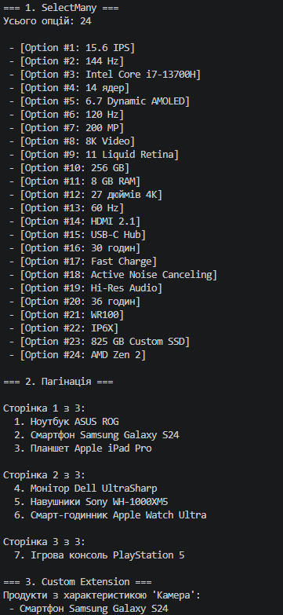

# Лабораторна робота №16 — LINQ: SelectMany, пагінація й custom extensions

**Виконав:** Щур Андрій  
**Група:** КН 3/1  
**Варіант:** 10  

---

## Опис проєкту

Консольний проєкт `.NET` (`lab16v10`), створений для практичного опанування розширених можливостей LINQ у мові C#. 

Основні цілі проєкту:
* Навчитися використовувати оператор `SelectMany` для проекції та об'єднання (flattening) вкладених колекцій у єдину плоску послідовність.
* Реалізувати механізм посторінкового виводу даних (пагінацію) за допомогою методів `Skip()` та `Take()`.
* Створити власний метод розширення (Extension Method) для ключової доменної сутності.

---

## Реалізовані запити

1. **SelectMany (Розгортання вкладених колекцій)**
   * Здійснює послідовну проекцію `SelectMany` для розгортання трирівневої ієрархії та отримання єдиного плоского списку всіх опцій (`Option`) з усіх характеристик (`Feature`) усіх продуктів (`Product`).

2. **Пагінація (Skip, Take)**
   * Реалізує посторінковий вивід списку продуктів по **3 елементи на сторінку**. Розрахунок загальної кількості сторінок виконується динамічно на основі загальної кількості елементів у колекції.

3. **Custom Extension Method (`HasFeature`)**
   * Створено метод розширення `HasFeature(this Product product, string featureName)`, який перевіряє наявність характеристики у продукту за її назвою без урахування регістру букв.

---

## Структура класів

Доменна модель реалізована через трирівневу структуру даних:

* **`Option`**: Модель вкладеної опції (`Id`, `Value`).
* **`Feature`**: Модель характеристики (`Id`, `Name`, `Options`), яка містить список опцій.
* **`Product`**: Основна модель продукту (`Id`, `Name`, `Features`), яка містить список характеристик.
* **`ProductExtensions`**: Статичний клас з методом розширення `HasFeature()`.
* **`Program`**: Точка входу в програму, що містить ініціалізацію тестового набору даних та виклики LINQ-запитів.

---

## Приклад
