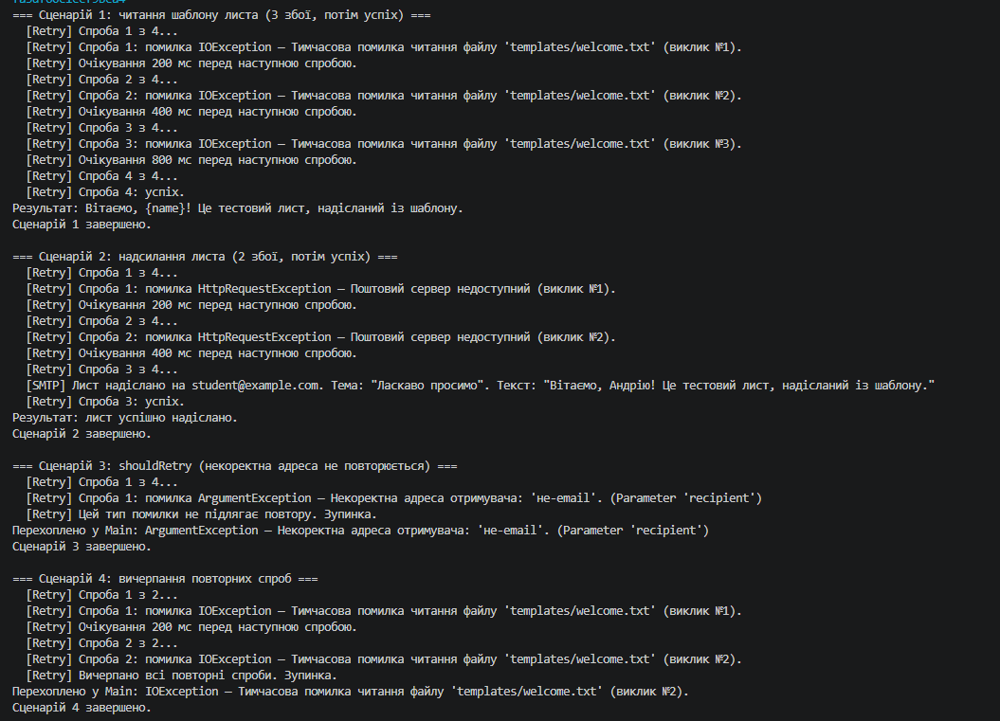

# Лабораторна робота №17 — Обробка IO/мережевих помилок та патерн Retry

**Виконав:** Щур Андрій  
**Група:** КН 3/1  
**Варіант:** 10  

---

## Опис проєкту

Консольний проєкт `.NET` (`lab17v10`), створений для практичного опанування обробки помилок вводу/виводу та мережевих помилок у мові C#.

Основні цілі проєкту:
* Навчитися обробляти типові винятки (`IOException`, `HttpRequestException`) за допомогою блоків `try-catch-finally`.
* Реалізувати узагальнений патерн **Retry** для підвищення відмовостійкості застосунку.
* Застосувати **експоненційну затримку** між повторними спробами.

---

## Сценарій варіанта 10: відправка електронного листа

1. **Читання шаблону листа (`FileProcessor.GetEmailTemplate`)**
   * Імітує `IOException` перші **3** рази, після чого повертає шаблон.

2. **Надсилання листа (`NetworkClient.SendEmail`)**
   * Імітує `HttpRequestException` перші **2** рази, після чого лист успішно "надсилається".

3. **Політика повторів (`shouldRetry`)**
   * Повторюються спроби лише для `IOException` та `HttpRequestException`.
   * Решта винятків (наприклад, `ArgumentException`) пробрасуються одразу.

---

## Реалізований патерн Retry

Метод `RetryHelper.ExecuteWithRetry<T>(Func<T> operation, int retryCount = 3, TimeSpan initialDelay = default, Func<Exception, bool> shouldRetry = null)`:

* виконує операцію та у разі помилки повторює її не більше `retryCount` разів;
* затримка перед повтором розраховується за формулою `initialDelay * 2^retryAttempt` (за замовчуванням початкова затримка — 200 мс);
* делегат `shouldRetry` визначає, чи варто повторювати спробу для конкретного винятку;
* кожна спроба та причина невдачі виводиться в консоль; після вичерпання спроб виняток пробрасується далі.

---

## Демонстраційні сценарії в `Main`

1. **Читання шаблону:** 3 збої `IOException`, успіх на 4-й спробі.
2. **Надсилання листа:** 2 збої `HttpRequestException`, успіх на 3-й спробі.
3. **Вибіркова обробка:** некоректна адреса викликає `ArgumentException`, повтори не виконуються.
4. **Вичерпання спроб:** при `retryCount = 1` операція не встигає завершитися успішно, виняток перехоплюється в `Main`.

Кожен сценарій обгорнуто в `try-catch-finally`.

---

## Структура класів

* **`FileProcessor`**: Імітує роботу з файлами, метод `GetEmailTemplate(string path)`.
* **`NetworkClient`**: Імітує мережеві запити, метод `SendEmail(string recipient, string subject, string body)`.
* **`RetryHelper`**: Статичний клас з узагальненим методом `ExecuteWithRetry<T>()`.
* **`Program`**: Точка входу в програму, що містить демонстраційні сценарії.

---

## Приклад
