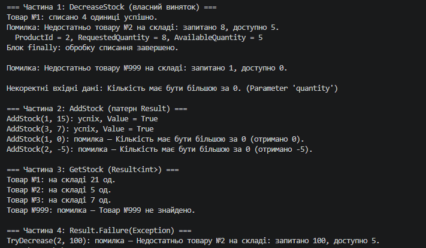

# Лабораторна робота №18 — Власні винятки та патерн Result

**Виконав:** Щур Андрій  
**Група:** КН 3/1  
**Варіант:** 10  

---

## Опис проєкту

Консольний проєкт `.NET` (`lab18v10`), створений для практичного опанування створення власних типів винятків та патерну `Result` у мові C#.

Основні цілі проєкту:
* Навчитися створювати власні типи винятків для специфічних помилок предметної області.
* Реалізувати узагальнений клас `Result<T>` для контрольованої обробки помилок без викидання винятків.
* Розрізняти ситуації, де доцільний виняток (виняткова ситуація), та ситуації, де краще повернути `Result` (очікувана невдача).

---

## Сценарій варіанта 10: управління інвентарем

1. **Власний виняток (`ProductOutOfStockException`)**
   * Викидається, якщо товару на складі недостатньо.
   * Містить додаткові властивості: `ProductId`, `RequestedQuantity` та `AvailableQuantity`.

2. **Метод `DecreaseStock(int productId, int quantity)`**
   * Списує товар зі складу.
   * Викидає `ProductOutOfStockException`, якщо запитана кількість перевищує залишок (або товару немає на складі).
   * Для некоректної кількості (`<= 0`) викидає `ArgumentOutOfRangeException`.

3. **Метод `AddStock(int productId, int quantity)`**
   * Повертає `Result<bool>`.
   * `Result.Success(true)` — якщо склад поповнено; `Result.Failure(...)` — якщо кількість `<= 0`.

4. **Додатковий метод `GetStock(int productId)`**
   * Повертає `Result<int>` з залишком товару або помилку, якщо товар не знайдено.

---

## Реалізований патерн Result

Клас `Result<T>`:

* властивості `IsSuccess` (`bool`), `Value` (`T`) та `Error` (`string`);
* приватний конструктор `Result(T value, bool isSuccess, string error)`;
* фабричні методи `Success(T value)`, `Failure(string error)` та `Failure(Exception ex)`.

---

## Демонстраційні сценарії в `Main`

1. **Власний виняток:** успішне списання, а потім спроба списати більше, ніж є на складі, — виняток перехоплюється через `try-catch-finally`, виводяться його додаткові властивості.
2. **Відсутній товар та некоректна кількість:** `ProductOutOfStockException` для неіснуючого товару та `ArgumentOutOfRangeException` для кількості `0`.
3. **Патерн Result (`AddStock`):** успішне поповнення та помилки для кількості `0` і `-5`, результат обробляється через `IsSuccess` та `Error`.
4. **`GetStock`:** отримання залишку існуючих товарів та помилка для товару, якого немає.
5. **`Result.Failure(Exception)`:** виняток обгортається у `Result` через допоміжний метод `TryDecrease`.

---

## Структура класів

* **`ProductOutOfStockException`**: Власний виняток зі стандартними конструкторами та властивостями `ProductId`, `RequestedQuantity`, `AvailableQuantity`.
* **`Result<T>`**: Узагальнений клас-результат з фабричними методами `Success` та `Failure`.
* **`InventoryService`**: Сервіс управління інвентарем з методами `DecreaseStock`, `AddStock`, `GetStock`.
* **`Program`**: Точка входу в програму, що містить демонстраційні сценарії.

---

## Приклад 
